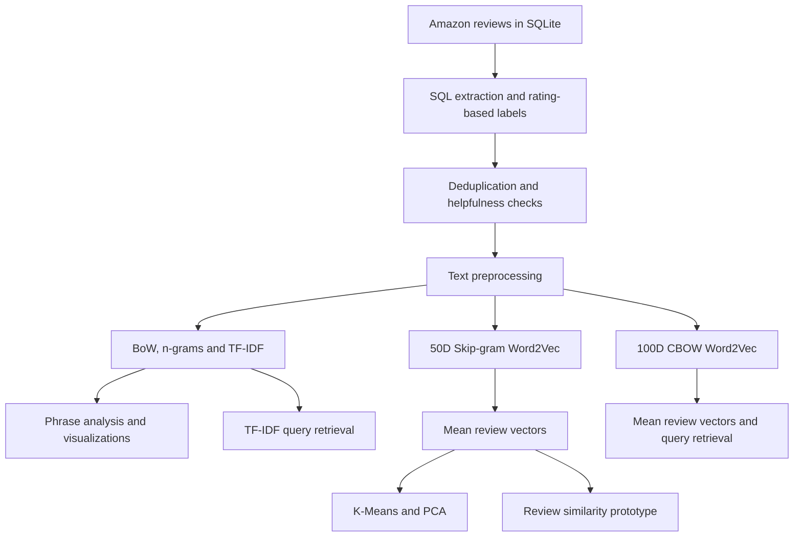

<div align="center">

# Amazon Review Intelligence

### Customer Feedback Exploration · Text Analytics · Review Search

**Turning 568,454 Amazon reviews into searchable text features and review embeddings.**


[Explore the notebook](AMAZON_NLP_PROJECT.ipynb) · [See the results](#results-at-a-glance) · [Run locally](#run-locally)

</div>

## Project overview

Customer reviews describe what people value, what disappoints them, and how they experience products. This project explores how NLP can make a large review collection easier to investigate through **text feature engineering, unsupervised grouping, and natural-language search**.

Starting with the Amazon Fine Food Reviews SQLite database, the notebook builds a workflow for SQL extraction, duplicate detection, text normalization, rating-based sentiment labels, sparse vectorization, Word2Vec embeddings, K-Means clustering, and cosine-similarity retrieval. It implements both TF-IDF keyword search and a Word2Vec semantic-search prototype.

The work demonstrates the ability to move from raw relational data to numerical representations, visual analysis, and an exploratory search use case. The current deliverable is a research notebook with saved outputs; model-quality and business-impact evaluation remain future work.

## Results at a glance

| Area | Implemented result |
| :--- | :--- |
| Source corpus | **568,454 reviews**, 74,258 products, 256,059 users |
| Cleaned analysis cohort | **365,331 reviews** after rating filtering and data-quality checks |
| Duplicate removal | **160,481 records** removed under the selected duplicate key |
| Feature engineering | **Five count/TF-IDF configurations**, including a 50,000-feature BoW matrix |
| Embedding experiments | **50-dimensional Skip-gram** and **100-dimensional CBOW** Word2Vec |
| Unsupervised grouping | **364,374 review vectors** assigned to **5 K-Means clusters** |
| Visual exploration | TF-IDF word cloud, ranked bigrams, feature heatmap, and PCA plot |
| Search prototypes | TF-IDF and Word2Vec query-to-review retrieval with top-5 examples |

**Evidence:** Corpus statistics and cleaning counts were checked against the local database and CSV exports. Feature shapes, cluster counts, and search examples below come from the current notebook's saved outputs. Training and the complete notebook were not rerun for this documentation review. These are implementation milestones, rather than accuracy or relevance benchmarks.

## Business relevance

| Customer-feedback question | Capability demonstrated | Potential application after validation |
| :--- | :--- | :--- |
| What product attributes appear in review language? | TF-IDF weighting and bigram exploration | Guide investigation of taste, dietary preferences, and value |
| Where are reviews describing freshness or refunds? | Natural-language query retrieval | Help analysts locate examples of customer complaints |
| How can a large collection be organized for inspection? | Mean Word2Vec embeddings and K-Means | Explore groups of feedback and develop candidate themes |
| Can the input data be trusted? | Duplicate checks and helpfulness consistency filtering | Establish a cleaner basis for downstream analysis |

These are possible uses of the demonstrated methods. The project has not measured reductions in review time, improvements in customer satisfaction, or commercial outcomes.

## Workflow



## Dataset and preparation

The input is the `Reviews` table in `database.sqlite`, distributed through [Kaggle's Amazon Fine Food Reviews dataset](https://www.kaggle.com/datasets/snap/amazon-fine-food-reviews). The local database spans **October 8, 1999–October 26, 2012**. The original dataset page is available from [Stanford SNAP](https://snap.stanford.edu/data/web-FineFoods.html).
Database Link: https://drive.google.com/file/d/17tIH6LRe-UsxwmAw49x2luOVLLB-sh4B/view?usp=sharing


The ten source columns cover review, product and user identifiers; profile name; helpful and total votes; star rating; timestamp; summary; and full review text. `Text` supplies the review content used for feature extraction and retrieval.

### Cleaning decisions

1. Exclude three-star reviews and map ratings of **1–2 to `negative`** and **4–5 to `positive`**.
2. Sort by `ProductId`, then remove duplicates using `UserId`, `ProfileName`, `Time`, `Summary`, and `Text`.
3. Remove records where `HelpfulnessNumerator > HelpfulnessDenominator`.
4. Export the cleaned cohort, then construct and save `CleanedText`.

| Preparation stage | Remaining reviews |
| :--- | ---: |
| Original database | 568,454 |
| Exclude 42,640 three-star reviews | 525,814 |
| Remove 160,481 duplicates under the selected key | 365,333 |
| Remove 2 inconsistent helpfulness records | **365,331** |

The duplicate key omits `ProductId`, so identical reviews repeated across products may collapse into one record. This is an analysis choice that affects the retained cohort.

The final labels contain **307,967 positive reviews (84.30%)** and **57,364 negative reviews (15.70%)**. These labels are derived from star ratings; the notebook does not train or evaluate a sentiment classifier.

### Text preprocessing

The pipeline removes URLs and HTML markup, expands common contractions, removes tokens containing digits, replaces nonalphabetic characters with spaces, filters a custom stopword set, and lowercases retained tokens. Beautiful Soup handles HTML parsing; regular expressions handle the other text substitutions.

The output is saved to `preprocessed_reviews.csv`. Its **957 empty cleaned-text entries** are omitted from the first Word2Vec pipeline, leaving **364,374 review embeddings**. Sparse vectorization and the later query-search pipelines preserve all 365,331 rows by filling missing cleaned text with empty strings.

## Feature engineering

The notebook explores complementary representations of the same review corpus. Count features encode occurrence, TF-IDF adds corpus-dependent term weighting, and averaged Word2Vec vectors supply dense review representations. See the [scikit-learn text feature extraction guide](https://scikit-learn.org/stable/modules/feature_extraction.html#text-feature-extraction) for the underlying vectorization methods.

| Representation | Configuration | Document–feature shape |
| :--- | :--- | :--- |
| Bag-of-Words | `max_features=50000` | `365331 × 50000` |
| Unigram + bigram counts | `ngram_range=(1,2)`, `min_df=10`, `max_features=5000` | `365331 × 5000` |
| Unigram TF-IDF | `max_features=5000` | `365331 × 5000` |
| Unigram + bigram TF-IDF for exploration | `ngram_range=(1,2)`, `max_features=8000` | `365331 × 8000` |
| Unigram + bigram TF-IDF for retrieval | `ngram_range=(1,2)`, `max_features=10000` | 365,331 rows; feature cap of 10,000¹ |
| Mean Skip-gram review embeddings | `vector_size=50`, `window=5`, `min_count=3`, `sg=1` | `364374 × 50` |
| Mean CBOW review embeddings for search | `vector_size=100`, `window=5`, `min_count=2`, default `sg=0` | 365,331 rows × 100 dimensions¹ |

¹ Dimensions inferred from the code and input row count; these matrix shapes are not explicitly printed in the saved notebook.

Count and TF-IDF outputs use SciPy sparse matrices. Only small slices are converted to dense arrays for inspection, keeping the full document–vocabulary matrices sparse.

Both Word2Vec experiments average in-vocabulary token vectors to represent a review, with a zero-vector fallback for reviews without usable vectors. The first uses Skip-gram; the second leaves `sg` at Gensim's CBOW default. Their dimensions and vocabulary thresholds differ, so they are separate configurations rather than a controlled comparison of training algorithms. See [Gensim's Word2Vec documentation](https://radimrehurek.com/gensim/models/word2vec.html).

## Visual findings

### Phrases surfaced by TF-IDF


The chart surfaces **“gluten free,” “highly recommend,” “taste like,” “peanut butter,”** and **“great price.”** These phrases offer starting points for investigating dietary attributes, product categories, taste, recommendations, and value.

Each bar sums TF-IDF weights across documents. The values are aggregate term weights, rather than review counts or sentiment scores. Corpus-wide weights also reflect the composition of this predominantly positive cohort.

### Review grouping with Word2Vec and K-Means

The notebook applies `KMeans(n_clusters=5, random_state=42)` to the 50-dimensional review vectors. The saved cluster distribution is:

| Cluster ID | Reviews |
| :--- | ---: |
| 0 | 58,513 |
| 1 | 60,999 |
| 2 | 44,730 |
| 3 | 107,486 |
| 4 | 92,646 |
| **Total** | **364,374** |


PCA projects a random sample of **10,000 vectors** into two dimensions for inspection. Both figures are exported from the current notebook's saved outputs. The notebook also contains a TF-IDF word cloud and a `120 × 120` feature heatmap.

Cluster IDs are numerical assignments. Named customer themes, the optimal cluster count, and cluster-quality scores have not been established. A two-dimensional projection alone cannot establish semantic coherence; see the [K-Means reference](https://scikit-learn.org/stable/modules/generated/sklearn.cluster.KMeans.html) for the estimator used.

## Natural-language review search

The notebook implements two query-to-review approaches:

- **TF-IDF retrieval:** Clean the query, transform it with the fitted 10,000-feature-cap unigram/bigram vectorizer, compute cosine similarity, and return the top reviews with their rating-derived labels.
- **Word2Vec retrieval:** Average query word vectors from the 100-dimensional model, compare against mean review vectors, and display the five highest-scoring reviews.

For the query **`refund due to stale food`**, the saved outputs show:

| Approach | Example behavior in the saved output | Highest displayed cosine score |
| :--- | :--- | ---: |
| TF-IDF | Surfaces stale-popcorn complaints and reviews mentioning refunds; all five returned labels are negative | 0.447 |
| Word2Vec | Surfaces complaints about stale popcorn, rancid nuts, refund restrictions, and a broken vial | 0.703 |

A second Word2Vec query, **`so tasty and flavour full food, very good taste`**, retrieves examples discussing taste, aroma, and flavor, with a highest displayed score of **0.866**.

These are qualitative demonstrations. Cosine similarity measures normalized vector alignment, as defined in the [scikit-learn reference](https://scikit-learn.org/stable/modules/generated/sklearn.metrics.pairwise.cosine_similarity.html); it is not an accuracy score or probability. Scores from different representation spaces do not establish which approach retrieves better results.

The earlier `get_similar_review()` function uses the separate 50D embeddings and has a row-alignment issue after empty-text rows are dropped. Its displayed examples require correction before they can support conclusions. The later TF-IDF and 100D query-search code preserve DataFrame row positions.

## Skills demonstrated

| Skill | Evidence in the project |
| :--- | :--- |
| SQL and data investigation | SQLite extraction, rating filters, duplicate analysis, helpfulness checks |
| NLP preprocessing | HTML/URL cleanup, contraction expansion, token filtering, reusable cleaned text |
| Feature engineering | BoW, n-grams, TF-IDF, and sparse document–term matrices |
| Representation learning | Domain-trained Skip-gram and CBOW word embeddings with mean pooling |
| Unsupervised learning | K-Means grouping and PCA exploration |
| Information retrieval | TF-IDF and embedding-based cosine ranking for natural-language queries |
| Technical communication | Visual outputs, documented cohort choices, and explicit evaluation boundaries |

**Stack:** Python · SQLite · pandas · NumPy · SciPy · Beautiful Soup · NLTK · scikit-learn · Gensim · Matplotlib · Seaborn · WordCloud · tqdm · Jupyter.

## Project structure

```text
AMAZON_FOOD_DATA_PROJECT/
├── README.md
├── AMAZON_NLP_PROJECT.ipynb          # Analysis, modeling, search, and saved outputs
├── assets/images/
│   ├── top-tfidf-bigrams.png
│   └── word2vec-kmeans-pca.png
├── database.sqlite                  # Source input; download separately
├── reviews_clean_file               # Generated CSV without a .csv extension
├── preprocessed_reviews.csv         # Generated cohort with CleanedText
└── word2vec_model_2.model            # Local model artifact; save call in notebook
```

The notebook is named **`AMAZON_NLP_PROJECT.ipynb`**. Data exports and the model artifact are local files and can be omitted from the GitHub repository.

## Run locally

### 1. Download the data

Obtain [Amazon Fine Food Reviews from Kaggle](https://www.kaggle.com/datasets/snap/amazon-fine-food-reviews), extract `database.sqlite`, and place it beside the notebook. The cleaned CSV files can be regenerated.

### 2. Prepare a Python environment

Run the following from the project directory. Python 3.12 is a starting point consistent with the notebook's kernel metadata; the original environment is not locked, and these setup commands have not been validated by a fresh complete run.

```bash
python3.12 -m venv .venv
source .venv/bin/activate
# Windows PowerShell activation: .venv\Scripts\Activate.ps1
python -m pip install --upgrade pip
python -m pip install jupyterlab ipykernel numpy pandas scipy matplotlib seaborn scikit-learn nltk beautifulsoup4 tqdm gensim wordcloud
python -m nltk.downloader punkt punkt_tab stopwords
python -m ipykernel install --user --name amazon-food-nlp --display-name "Amazon Food NLP"
python -m jupyter lab AMAZON_NLP_PROJECT.ipynb
```

Select the **Amazon Food NLP** kernel. The notebook also contains installation cells; install packages into the selected kernel's environment.

### 3. Replace the two machine-specific paths

In the database-connection cell, set:

```python
from pathlib import Path

db_path = str(Path("database.sqlite").resolve())
con = sqlite3.connect(db_path)
```

In the later cell that reloads the preprocessed data before Word2Vec, set:

```python
final = pd.read_csv("preprocessed_reviews.csv")
```

Run cells from top to bottom with the project directory as the working directory. The full corpus, token lists, feature matrices, and two embedding experiments can consume substantial memory; runtime and peak memory have not been benchmarked. Resolve the saved Word2Vec runtime messages described below before relying on regenerated embeddings.

## Evaluation status and roadmap

The completed scope covers preparation, feature construction, visualization, clustering, and exploratory retrieval. The notebook does not report classification accuracy/F1, retrieval relevance metrics, cluster-quality metrics, or production deployment results.

<details>
<summary><strong>Technical review and next development steps</strong></summary>

1. **Establish a clean reproducible run.** Saved installation logs and kernel metadata refer to different Python environments. Both Word2Vec training cells contain low-level `word2vec_inner.our_dot_float` exception messages. Diagnose compatibility and rerun in a consistent environment before treating the learned representations as validated. Some later cells have saved outputs despite missing execution counts or changed print text, so the outputs do not certify an ordered run of the current source.
2. **Correct earlier similarity display.** The first Word2Vec pipeline drops 957 missing texts, but `get_similar_review()` indexes the unfiltered `final` DataFrame. Retain original row IDs or display from the same filtered frame. Exclude the query index explicitly instead of assuming the highest-ranked result is always the query.
3. **Unify query and corpus preprocessing.** Stopwords are checked before lowercasing in corpus cleaning, allowing capitalized stopwords to survive. The custom set includes negations such as `not` and `never`; revisit this choice before sentiment modeling. TF-IDF queries use a different stopword list, and Word2Vec queries currently use lowercase whitespace splitting. Share one preprocessing function, handle empty/out-of-vocabulary queries, and inspect non-food records visible in the corpus.
4. **Evaluate retrieval relevance.** Build a human-reviewed query set covering freshness, refunds, taste, and dietary needs. Compare TF-IDF and Word2Vec using Precision@k, Recall@k where relevance judgments are sufficiently complete, and nDCG@k for graded relevance. Inspect repetition-heavy matches and unrelated results.
5. **Validate cluster interpretation.** Review representative texts and terms per cluster, test candidate cluster counts, and measure sampled silhouette scores. Seed the random PCA sampling step. Multithreaded Word2Vec can vary between runs; record training settings and dependencies.
6. **Add supervised sentiment baselines.** Use a leakage-aware train/test split and fit vectorizers only on training data. Report macro-F1, per-class recall, and a confusion matrix given the 84.30% positive-class share. Check the effect of removing neutral reviews.
7. **Improve reuse.** Lock a working environment, persist preprocessing/vectorizer configurations and row mappings, and package retrieval behind a small demo or API after quality evaluation. Stemming and lemmatization are imported but are not currently applied.

</details>

## Dataset attribution and technical references

Dataset provenance: [Stanford SNAP — Amazon Fine Foods Reviews](https://snap.stanford.edu/data/web-FineFoods.html). Distribution used: [Kaggle — Amazon Fine Food Reviews](https://www.kaggle.com/datasets/snap/amazon-fine-food-reviews). The corpus statistics in this README were independently checked against the local SQLite file.

Associated research citation: J. McAuley and J. Leskovec. *From amateurs to connoisseurs: modeling the evolution of user expertise through online reviews.* WWW, 2013.

Method references: [Text feature extraction](https://scikit-learn.org/stable/modules/feature_extraction.html#text-feature-extraction) · [Gensim Word2Vec](https://radimrehurek.com/gensim/models/word2vec.html) · [K-Means](https://scikit-learn.org/stable/modules/generated/sklearn.cluster.KMeans.html) · [Cosine similarity](https://scikit-learn.org/stable/modules/generated/sklearn.metrics.pairwise.cosine_similarity.html).

## GitHub publishing notes

Publish the notebook, README, and linked figures. Download the dataset separately: the local database is approximately **356 MiB**, and the two CSV exports are approximately **186 MiB** and **269 MiB**. GitHub blocks regular Git files larger than **100 MiB**; see [GitHub's large-file guidance](https://docs.github.com/en/repositories/working-with-files/managing-large-files/about-large-files-on-github).

<details>
<summary><strong>Suggested .gitignore and repository metadata</strong></summary>

Create a `.gitignore` before staging files:

```gitignore
.venv*/
.vscode/
.DS_Store
__pycache__/
.ipynb_checkpoints/
.env
.env.*
database.sqlite
reviews_clean_file
preprocessed_reviews.csv
word2vec_model_2.model*
```

**Suggested repository description**

> NLP exploration of 568K Amazon reviews using SQL cleaning, TF-IDF, Word2Vec, K-Means, and natural-language review search.

**Suggested topics**

`nlp` · `text-mining` · `amazon-reviews` · `customer-feedback` · `python` · `sql` · `tf-idf` · `word2vec` · `kmeans-clustering` · `semantic-search` · `information-retrieval` · `data-science`

</details>

